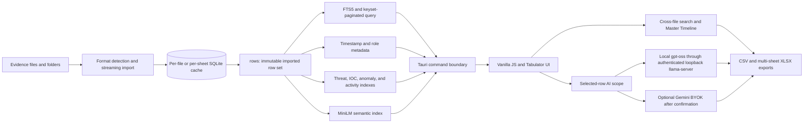
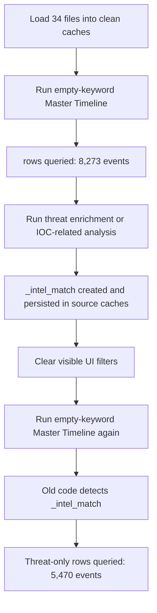

# logparser-DFIR Engineering Build, Architecture, and Release Report

**Document date:** 2026-11-07  
**Repository:** `biancanik-art/logparser-DFIR`  
**Documented release:** `v0.3.9`  
**Release commit:** `3b9dbe7e75fcc8ce29761650bbc612cfce24e467`  
**Application package version:** `0.3.9`  
**License:** Apache License 2.0  
**Release page:** <https://github.com/biancanik-art/logparser-DFIR/releases/tag/v0.3.9>

## 1. Purpose and scope

This report documents how logparser-DFIR was conceived, implemented, tested, packaged, and released. It is intended to be useful to:

- DFIR examiners who need to understand what the application does to evidence;
- maintainers who must rebuild or modify the application without breaking forensic invariants;
- reviewers who need a traceable explanation of the 8,273-versus-5,470 Master Timeline defect;
- release engineers who need reproducible build and release procedures;
- security reviewers assessing local AI, cloud AI, filesystem, and supply-chain behavior.

The report covers the repository state represented by release `v0.3.9`. It also records post-release operational findings that were observed while exercising the local gpt-oss integration on Windows systems. Those findings are deliberately separated from implemented and verified behavior.

This is an engineering report, not a forensic validation certificate. It documents the code paths, controls, tests, release evidence, and known limitations. Any organization using the tool in a regulated or evidentiary context should perform its own validation against representative evidence and its own chain-of-custody procedures.

### 1.1 Sources of truth

The following sources were used, in descending order of authority:

1. The source code and configuration at commit `3b9dbe7`.
2. The annotated `v0.3.9` Git tag and the GitHub release assets.
3. The successful GitHub Actions release run `42125886731`.
4. Repository regression tests and the local verification described in section 15.
5. Git history for feature chronology.
6. [`MEMORY.md`](MEMORY.md) for historical investigation notes.

`MEMORY.md` is useful historical evidence, but it contains stale version and path references. Where it conflicts with `Cargo.toml`, `tauri.conf.json`, Git tags, or the code at `HEAD`, this report follows the code and release metadata.

### 1.2 Status language used in this report

- **Implemented** means the behavior exists in the documented source tree.
- **Regression-tested** means an automated test exists for the behavior.
- **Release-verified** means the relevant release workflow completed successfully.
- **Live-verified** means the behavior was observed in the running application against the stated evidence set.
- **Known limitation** means behavior that is implemented but is not reliable or sufficiently observable in one or more documented operating conditions.
- **Proposed** means the item is not part of `v0.3.9`.

## 2. Executive summary

logparser-DFIR is a native desktop forensic log viewer and correlation workbench. It was built to let an examiner load heterogeneous evidence without first forcing it into one global schema. Each source file or workbook sheet is imported into a dedicated, content-keyed SQLite cache. The application then provides paginated search, timestamp normalization, offline semantic retrieval, indicator extraction, threat enrichment, cross-file correlation, Master Timeline construction, and XLSX/CSV reporting.

The application uses:

- a plain HTML/CSS/JavaScript frontend rendered by Tauri;
- a Rust backend exposed through explicit Tauri commands;
- SQLite with FTS5 for per-source storage and full-text retrieval;
- Rust-native parsers for CSV, Excel, JSON, JSONL, gzip streams, EVTX, XML, and text/syslog evidence;
- Aho-Corasick and deterministic rules for offline threat matching;
- an embedded all-MiniLM-L6-v2 model for offline semantic retrieval;
- an optional post-install `gpt-oss-20b` GGUF model executed by a bundled, authenticated, loopback-only llama.cpp server;
- optional Google Gemini cloud inference using an examiner-provided API key and an explicit transfer confirmation.

The defining forensic design decision is that raw imported rows remain the primary data. Derived state—full-text indexes, timestamp indexes, semantic indexes, threat matches, anomaly results, and AI output—is stored separately and must not silently change the meaning of an unfiltered evidence query.

That invariant was violated by the Master Timeline defect fixed in `v0.3.8`: an empty-keyword timeline used the derived `_intel_match` table if a prior threat scan had created it. The same 34 evidence files therefore produced 8,273 events before the scan and 5,470 after it. The fix made the empty-keyword path always query `rows`. A regression test and live 34-file verification established that persisted threat-enrichment state no longer changes this query path.

Release `v0.3.9` added grounded selected-row AI analysis, citation verification, an exportable AI Attack Timeline, the post-install local model manager, a managed llama.cpp runtime, and hardened release packaging. The release is published for Windows x64, Linux x64, macOS Apple Silicon, and macOS Intel. The core forensic workflows and release pipeline are operational. The local 20B model path has a documented post-release limitation on CPU-only or memory-constrained systems: non-streaming generation can exceed the fixed ten-minute request timeout, after which the frontend may restart the server and repeat the request. This is not caused by selecting 12 rows; it is a runtime latency and observability problem described in section 17.

## 3. Product problem and engineering goals

### 3.1 Problem being solved

Incident-response evidence normally arrives as many incompatible exports:

- endpoint telemetry with hundreds of thousands of rows;
- Windows Event Logs;
- Sentinel, EDR, firewall, VPN, browser, cloud, and M365 exports;
- structured and semi-structured JSON;
- spreadsheets with multiple sheets;
- raw text, syslog, rotated logs, and gzip-compressed logs;
- files with missing, duplicated, malformed, or synthetic headers.

Traditional spreadsheet workflows struggle with this combination. Global flattening creates extremely sparse tables, large in-memory joins are expensive, and examiner actions can become difficult to reproduce. The application therefore needed to keep evidence sources independent while still allowing global pivots and a unified chronological view.

### 3.2 Primary goals

1. Preserve every imported raw row and its source provenance.
2. Avoid a fixed source schema.
3. Support files with 100,000 or more rows without loading the whole file into the webview.
4. Keep filtering and sorting deterministic and bounded.
5. Correlate across multiple source-specific caches without destructive merging.
6. Keep core analysis usable with no internet connection and no generative model.
7. Make all AI-assisted conclusions traceable to source file and row.
8. Require an explicit examiner action before evidence is sent to a cloud provider.
9. Produce practical CSV and XLSX deliverables.
10. Package the same product for Windows, Linux, macOS Apple Silicon, and macOS Intel.

### 3.3 Forensic invariants

The following invariants are load-bearing:

- Source evidence files are read, not modified.
- Each imported row has a stable `row_num` inside its source cache.
- Source path, sheet, source row, and normalized timestamp are carried as provenance where applicable.
- Derived tables cannot silently replace `rows` as the meaning of an unfiltered query.
- Clearing a UI filter does not claim to delete derived scan results; query construction must explicitly decide whether derived state is in scope.
- Pagination is stable because `row_num` is the deterministic tie-breaker.
- AI citations must match staged provenance before they are treated as verified.
- A partial AI batch cannot claim complete coverage.
- Cloud evidence transfer requires examiner confirmation at the time of transfer.
- Downloaded executable/model resources must be pinned or verified before use.

### 3.4 Development provenance and collaboration model

The product concept, examiner workflow, requirements, and live-case feedback were directed by `biancanik-art`. Gemini and Codex were used as engineering agents at different stages of the implementation and review. In practice, the development loop was:

1. the examiner described an operational need or reproduced a failure in the running application;
2. an engineering agent inspected the relevant Rust, JavaScript, SQLite, build, or release path;
3. the proposed change was reduced to explicit behavior and forensic invariants;
4. code and regression tests were implemented;
5. a second review or subsequent agent inspected the resulting source and test output;
6. the application was rebuilt and exercised against the real evidence workflow where possible;
7. a tagged CI release was created only after repository and release checks.

The Master Timeline defect is the clearest example: the examiner supplied the two observed counts and the sequence that caused them; source inspection identified the hidden `_intel_match` dependency; the backend branch and Refresh behavior were corrected; a regression test was added; and the 34-file case was rerun with persisted scan tables.

AI-assisted engineering does not make a change trustworthy on its own. The durable evidence is the reviewed source, Git history, regression tests, live reproduction record, pinned build inputs, and published release workflow. This report therefore attributes product and engineering roles while using those technical artifacts—not an agent's narrative—as the source of truth.

## 4. System architecture



### 4.1 Component boundaries

| Layer | Main implementation | Responsibility |
| --- | --- | --- |
| Desktop shell | Tauri v2 | Native window, resource resolution, dialogs, command bridge, packaging |
| Frontend | [`frontend/index.html`](frontend/index.html), [`frontend/app.js`](frontend/app.js), [`frontend/style.css`](frontend/style.css) | UI state, Tabulator grid, selection, correlation workflows, AI conversations, transfer confirmation |
| Command boundary | [`src-tauri/src/lib.rs`](src-tauri/src/lib.rs), [`src-tauri/src/commands.rs`](src-tauri/src/commands.rs) | Whitelisted frontend-to-Rust operations and application state |
| Import | `csv_import.rs`, `excel_import.rs`, `universal_import.rs`, `tabular_import.rs` | Format detection, parsing, schema discovery, streaming insertion, import audit |
| Storage | [`src-tauri/src/db.rs`](src-tauri/src/db.rs) | Cache identity, SQLite connections, schema, FTS5, derived tables, recovery controls |
| Query | [`src-tauri/src/query.rs`](src-tauri/src/query.rs) | Bounded query expressions, parameterization, stable sorting, keyset pagination |
| Semantic retrieval | [`src-tauri/src/semantic.rs`](src-tauri/src/semantic.rs) | Embedded MiniLM inference, bounded document construction, semantic mappings, audit snapshots |
| Intel and correlation | [`src-tauri/src/intel/`](src-tauri/src/intel/) | IOC extraction, MITRE-style matching, activities, anomalies, chains, timestamp normalization, analyst orchestration |
| Reporting | `export.rs`, `universal_export.rs`, `report.rs` | CSV/XLSX output, unified workbooks, forensic audit sheets |
| Cloud AI | [`src-tauri/src/cloud_ai.rs`](src-tauri/src/cloud_ai.rs) | Validated and bounded Gemini HTTP requests and redacted errors |
| Local model lifecycle | [`src-tauri/src/local_ai_manager.rs`](src-tauri/src/local_ai_manager.rs) | Explicit download, resume, cancellation, SHA-256 verification, removal |
| Local inference runtime | [`src-tauri/src/local_ai_runtime.rs`](src-tauri/src/local_ai_runtime.rs) | llama-server process supervision, authentication, strict limits, grounded response post-processing |
| Build resources | [`scripts/`](scripts/) | Checksum-pinned MiniLM and llama.cpp runtime acquisition |
| Release automation | [`.github/workflows/release.yml`](.github/workflows/release.yml) | Four-platform tests, build, packaging, and GitHub release publication |

### 4.2 Why Tauri and Rust were selected

Tauri permits a small native shell around a web UI while keeping filesystem, process, network, and database operations in Rust. The browser layer cannot call arbitrary native functionality; it invokes only commands registered in `src-tauri/src/lib.rs`. This provides a clearer boundary than giving JavaScript direct access to the filesystem or shell.

Rust was also a practical fit for:

- streaming parsers and bounded memory use;
- SQLite and FTS5 integration;
- native XLSX generation;
- process supervision for llama.cpp;
- checksum verification and hardened filesystem checks;
- parallel cross-file work without moving the entire dataset into the webview.

The frontend intentionally has no compilation or bundling stage. Tauri packages `frontend/` directly, and Tabulator assets are vendored under `frontend/vendor/`.

## 5. Repository organization

```text
logparser-DFIR/
├── .github/workflows/release.yml      Four-platform release pipeline
├── frontend/
│   ├── app.js                         Application UI and workflow logic
│   ├── index.html                     Desktop UI structure
│   ├── style.css                      Visual design and state styles
│   ├── tests/                         Node regression harnesses
│   └── vendor/tabulator/              Vendored data-grid library
├── scripts/
│   ├── fetch_llm_resources.py         Pinned MiniLM resource acquisition
│   ├── fetch_llama_runtime.py         Pinned llama.cpp runtime acquisition
│   └── test_fetch_llama_runtime.py    Archive and publication security tests
├── src-tauri/
│   ├── Cargo.toml                     Rust package and dependency manifest
│   ├── Cargo.lock                     Locked Rust dependency graph
│   ├── tauri.conf.json                Desktop, CSP, bundle, and resource config
│   ├── resources/                     Embedded intel, MiniLM, and runtime assets
│   ├── src/                           Rust implementation
│   └── tests/                         Integration and end-to-end tests
├── testdata/                          Synthetic and regression evidence
├── LICENSE                            Apache-2.0 project license
├── NOTICE                             Third-party and attribution notices
├── MEMORY.md                          Historical engineering/investigation notes
└── README.md                          User-facing overview and quick build guide
```

## 6. Evidence ingestion architecture

### 6.1 File and folder discovery

The folder scanner in `commands.rs` is recursive by default, with a maximum depth of 12. It skips hidden directories and common non-evidence trees such as `node_modules`, `target`, `$Recycle.Bin`, and `System Volume Information`. Results are sorted by path for deterministic presentation.

Recognized evidence includes:

- `.csv`, `.tsv`, `.tab`;
- `.xls`, `.xlsx`, `.xlsb`, `.ods` for direct file selection;
- `.json`, `.jsonl`, `.ndjson`;
- `.json.gz`, `.jsonl.gz`, `.log.gz`, `.txt.gz`, and generic `.gz` logs;
- `.evtx`;
- `.xml`;
- `.log`, `.syslog`, `.txt`;
- extensionless `syslog`, `messages`, and `auth.log`;
- rotated log names such as `auth.log.1`, `syslog.2`, and `messages.3`.

The recursive folder predicate currently omits `.xlsm`, even though the direct format detector accepts `.xlsm`. That inconsistency is recorded as a maintenance issue in section 18.

### 6.2 Format detection

`universal_import::detect_format` combines extension checks with content sniffing:

- generic gzip content is decompressed and the first non-empty record is inspected;
- `.log`, `.txt`, rotated, and extensionless logs are distinguished between JSON Lines and syslog/text;
- a UTF-8 byte-order mark is skipped;
- JSONL detection requires the first non-empty line to be a valid JSON object;
- standard CSV and TSV use the optimized delimited importer;
- Excel formats use `calamine`;
- other supported streams use the universal importer.

This avoids a destructive assumption that every `.log` is unstructured text or every `.gz` contains JSON.

### 6.3 Schema discovery and row preservation

The universal importer samples up to 10,000 records to discover a source-specific schema. It sanitizes headers for SQLite while retaining original names in `_meta`. Wide universal sources are bounded to 350 table columns. Nested JSON is flattened into field paths, and the original-key-to-SQL-column mapping is retained so punctuation and nested names do not silently become `NULL` during insertion.

Rows are inserted in 5,000-record transactions. The source row ordinal becomes `row_num`, the primary key. Audit tables record parse failures and ingest metadata. Headerless or raw records are assigned synthetic field names rather than discarding the first line as a presumed header.

### 6.4 SQLite cache identity

Every file or workbook sheet receives its own SQLite cache. The cache key hashes:

- the canonical source path;
- source file size;
- modification time at nanosecond precision where available;
- the exact sheet name;
- the cache schema version marker, currently `cache-v2`.

The exact sheet name is included in the hash because two sheet names can produce the same filesystem-safe slug. A changed source size or modification time causes a new cache key, preventing the application from silently serving stale data after the source changes.

On Windows, regenerable caches are normally under:

```text
%LOCALAPPDATA%\log-parser\cache\
```

On macOS, cache data uses `~/Library/Caches`. User-authored application data uses the platform application-data directory rather than the temporary directory.

### 6.5 Core cache schema

The central tables are:

| Table | Purpose |
| --- | --- |
| `rows` | Imported source rows; `row_num` is the primary key |
| `_meta` | Original name, SQL name, index, and inferred type for each source column |
| `_import_info` | Source path, sheet, row count, and import timestamp |
| `rows_fts` | External-content FTS5 index over imported columns |
| `_column_roles` | Inferred or examiner-confirmed semantic roles |
| `_row_time` and related operation tables | Normalized timestamp index and recoverable publication state |
| `_intel_match` | Derived threat/MITRE-style matches |
| `_anomaly` | Derived anomalies |
| `_row_activity` | Derived activity categories |
| `_ignored_rows` and rule tables | Derived suppression state and rule overrides |
| `_semantic_v2_*` | Semantic documents, row mappings, selections, and immutable audit snapshots |
| `_parse_failures`, `_ingest_audit` | Parsing and ingest accountability |
| `_universal_iocs`, `_ioc_matches` | Universal IOC definitions and matches |

`rows` is primary evidence data inside the cache. The underscore-prefixed tables are metadata or derived analysis state. A core maintenance rule is that the existence of a derived table must never implicitly redefine an unfiltered raw-row operation.

### 6.6 SQLite runtime behavior

Connections use bounded waits and cache settings intended for concurrent page reads and short background write transactions. Imports temporarily use import-oriented pragmas and restore normal settings only after a complete import. `_import_info` acts as the completion marker: a crash during import leaves no valid completion record, so the application reparses instead of trusting a partial cache.

## 7. Query, filtering, and pagination

### 7.1 Structured query safety

The frontend does not send SQL. It sends a structured query specification. The Rust query builder validates identifiers against imported metadata, emits SQL fragments itself, and binds values as parameters.

Current hard limits include:

- maximum expression depth: 8;
- maximum expression nodes: 128;
- maximum individual query value length: 4,096 characters;
- maximum row-ID filter: 1,000 IDs;
- maximum query parameters: 2,048.

FTS search text is wrapped as a literal phrase with embedded quotes escaped. This prevents log text containing punctuation or Boolean-looking tokens from becoming FTS syntax.

### 7.2 Keyset pagination

The grid uses keyset pagination, not large `OFFSET` scans. Default order is `row_num ASC`. When another column is selected, `(sort_column, row_num)` provides a stable cursor and tie-breaker. This matters for repeated values such as identical timestamps or event IDs.

The webview receives one page at a time. This is why the application can interact with evidence containing hundreds of thousands or more rows without rendering every row at once.

### 7.3 UI filters versus derived indexes

There are distinct state categories:

- active grid filters and quick search;
- time-window filters;
- hidden rows or columns in the current view;
- persisted timestamp, semantic, IOC, or threat indexes in SQLite;
- selected rows staged for AI analysis.

Clearing the grid filters resets the active query state. It does not delete derived indexes. Correctness therefore depends on the backend selecting the appropriate source table explicitly. The Master Timeline incident in section 12 demonstrates why this separation must be enforced in code.

## 8. Data mapping and timestamp normalization

### 8.1 Data mapping

The application infers roles such as timestamp, user, host, action, source, and detail from dynamic source columns. Examiners can confirm or override mappings. Mapping does not delete fields and does not limit which raw fields can be inspected or selected for AI.

### 8.2 Why a timezone is sometimes required

A timestamp such as `2026-10-04 22:12:00` contains no offset. It cannot be converted to UTC without an external assumption. The tool therefore prompts for one of:

- `UTC`, `Z`, `GMT`, or `Etc/UTC`;
- a fixed offset such as `+02:00` or `UTC-07:00`;
- a supported abbreviation such as `PDT` or `PST`;
- an IANA zone such as `America/Los_Angeles` or `Europe/Bucharest`.

Current code treats `PDT` as the fixed offset UTC-07:00 and `PST` as UTC-08:00. An IANA zone is preferable when an evidence set crosses daylight-saving transitions because it applies historical transition rules. A fixed abbreviation is appropriate only when the examiner knows that the source consistently used that offset.

Ambiguous or nonexistent local times in an IANA zone are rejected rather than silently guessed. Normalized timestamps are published to `_row_time`, indexed by `(epoch_ms, row_num)`, and the operation tables support bounded recovery if normalization is interrupted.

## 9. Threat enrichment, IOC extraction, and correlation

### 9.1 Deterministic threat matching

The application ships built-in JSON resources for:

- a curated MITRE ATT&CK-style core library;
- ignore rules;
- a BEC-focused library;
- VPN ranges.

Aho-Corasick supports multi-pattern scanning. Matches are written to `_intel_match` with source row, tactic, technique, pattern, matched keyword, column, and score. This data is explicitly derived and can be used for threat-only filters and reports.

### 9.2 IOC processing

IOC extraction and universal IOC scans support common categories such as IPs, domains, hashes, emails, URLs, users, tokens, and high-entropy correlation identifiers. Cross-file occurrence data is kept with file and row provenance. Examiners can export overlap results separately or include searched IOC results in the forensic workbook.

### 9.3 Cross-file architecture

Multi-file operations keep the per-source caches intact. A `FileTarget` resolves or creates the cache for a source and sheet. Cross-file searches execute against those caches and merge bounded result objects in the application layer. The unified grid retains:

- source filename and path;
- source row number;
- normalized timestamp if available;
- common mapped fields;
- MITRE tags;
- the union of populated raw fields.

This avoids creating one permanent sparse mega-table while still allowing a unified chronological presentation.

## 10. Master Timeline construction

### 10.1 Timeline semantics

The Targeted Hunt and Master Timeline workflow accepts:

- an optional UTC time window;
- optional indicators or keywords;
- all currently loaded file targets.

For each source cache, the backend finds candidate row numbers, loads mapped time and evidence details, and emits correlated events. The frontend sorts and renders the unified event set and can export the active set.

### 10.2 Important sampling qualifier

When the keyword set is empty, `find_matching_timeline_rows` currently queries:

```sql
SELECT row_num FROM rows ORDER BY row_num ASC LIMIT 500
```

for each file or sheet. Therefore, the observed 8,273 events across 34 files are the complete result of the current **up-to-500-rows-per-source timeline policy**. They are not a claim that all 543,050 or 1,011,826 raw rows visible in example cases were loaded into the Master Timeline.

This distinction matters in forensic reporting. The Master Timeline is a correlated event view built under a bounded per-source candidate policy. The Evidence Grid and source caches retain the full imported row sets.

## 11. User interface and examiner workflow

### 11.1 Primary areas

The current interface exposes:

- **Evidence Grid** for source and unified row inspection;
- **AI Evidence Assistant** for selected-row questions and advanced evidence search;
- **Targeted Hunt & Master Timeline** for cross-file indicators, time windows, and chronological correlation;
- **Extracted IOCs** for multi-file indicator review;
- **Threat Enrichment** for deterministic matches and attack chains;
- **Data Mapping & Rules** for roles, ignores, and timestamp normalization;
- **Settings** for local model lifecycle and optional Gemini BYOK.

### 11.2 Evidence selection

The grid supports discrete and range selection. In the Master Timeline, the action button converts the selected rows into an AI selection scope with provenance. The selection scope is capped at 25,000 rows in the frontend. It is then divided into safe chunks according to provider-specific row and payload limits.

For local analysis, each direct chunk is bounded by the backend to:

- 75 rows;
- 60 populated columns;
- 48,000 serialized JSON characters;
- 8,000 prompt characters;
- six prior conversation messages;
- 24,000 total conversation-history characters.

Large valid selections are processed as ordered chunks. The coverage text records exactly how many selected rows were supplied. Cancellation occurs after the current chunk. A failed or cancelled run explicitly avoids claiming full coverage.

### 11.3 Provenance and citations

The staged JSON includes source file, sheet, source row, and timestamp provenance. The local backend parses citations from the model response and verifies them against the staged evidence lookup. Gemini citations are likewise filtered in the frontend against the selected provenance. Unmatched citations are removed or marked unverified.

Only cited selected rows are added to the AI Attack Timeline export set. This does not make the model conclusion factually correct; it ensures that an exported conclusion has an existing cited row in the staged selection.

## 12. Formal defect case study: 8,273 versus 5,470 events

### 12.1 Incident statement

The same 34 loaded KAPE evidence files produced two different empty-keyword Master Timeline counts:

- 8,273 correlated events on the initial clean run;
- 5,470 correlated events after an examiner ran threat enrichment or filters, cleared visible filters, and ran the Master Timeline again.

No active grid filter was visible during the second run. Two examiners could therefore reach different results from the same evidence set and apparent UI state.

### 12.2 Reproduction sequence



### 12.3 Root cause

The old empty-keyword branch in `intel/analyst.rs` checked whether `_intel_match` existed. If it did, the function returned distinct threat-match row numbers. It queried `rows` only when `_intel_match` did not exist or was empty.

The table's existence depended on investigation history:

1. A fresh import had no `_intel_match`, so the empty timeline sampled `rows`.
2. Threat enrichment created and populated `_intel_match` in the on-disk cache.
3. Clearing a frontend filter did not and should not delete that derived scan table.
4. The next empty timeline silently changed its data source from `rows` to `_intel_match`.

The defect was therefore not a Tabulator display bug and not missing evidence. It was a backend query-semantic bug caused by using persistent derived state as an implicit mode flag.

### 12.4 Implemented correction

Commit `1e6027d` removed the `_intel_match` preference from the empty-keyword branch. The current code is:

```rust
if keywords.is_empty() {
    let mut stmt = conn.prepare(
        "SELECT row_num FROM rows ORDER BY row_num ASC LIMIT 500"
    )?;
    let rows: Vec<i64> = stmt
        .query_map([], |r| r.get(0))?
        .collect::<rusqlite::Result<Vec<_>>>()?;
    return Ok(rows);
}
```

Threat-only timeline behavior remains available through explicit threat filters. It no longer activates merely because `_intel_match` happens to exist.

The Refresh button was also changed so that an empty search field runs `runCrossBatchSearch()` rather than only repainting stale scope state.

### 12.5 Regression test

`empty_timeline_ignores_persisted_intel_matches` creates:

- a `rows` table;
- a populated `_intel_match` table containing only rows 2, 4, and 6;
- a larger raw row set.

It asserts that an empty keyword list returns raw row numbers in ascending order and ignores the persisted threat rows.

### 12.6 Live verification

On 2026-11-02, the original 34-file case was loaded with caches that already contained `_intel_match`. The empty Master Timeline returned 8,273 correlated events. Pressing Refresh reran the query and again returned 8,273.

The verified guarantee is therefore:

> For the same source caches and current per-source sampling policy, an empty-keyword Master Timeline uses `rows` whether or not a prior threat scan created `_intel_match`.

It is not a guarantee that every raw evidence row appears in the Master Timeline, because the current empty-keyword policy is capped at 500 rows per source.

### 12.7 General lesson

Persistent analysis tables must be treated as named inputs, never as hidden UI state. Future derived indexes should satisfy all three requirements:

1. Query mode is explicit in the request.
2. The backend selects the corresponding table explicitly.
3. A regression test populates unrelated derived tables and proves they do not affect the operation.

## 13. Offline search and AI architecture

The phrase “AI” refers to three different subsystems. They must not be conflated.

### 13.1 Deterministic offline planning and rules

Many searches do not require a generative model. The guided-query pipeline can construct bounded structured queries using deterministic parsing, known field roles, IOC patterns, and validated plans. Threat scanning, IOC extraction, Base64/URL/backtick/caret deobfuscation, and offline incident narrative functions also have deterministic paths.

These features work without downloading gpt-oss and without configuring Gemini.

### 13.2 Embedded MiniLM semantic retrieval

The installer contains all-MiniLM-L6-v2 resources used by Candle for local embeddings. Semantic documents are bounded and mapped back to raw rows. The semantic-v2 schema includes build identity, documents, row mappings, selections, and immutable audit snapshots.

Relevant limits include:

- 256 tokens per embedding input;
- 4,096 query characters;
- 1,000 semantic results;
- 1,024 candidate documents;
- 16,384 input characters per source cell;
- 2,048 characters per semantic document;
- bounded chunks and mappings per row/build.

The embedded semantic model is a retrieval component, not the conversational assistant.

### 13.3 Optional local gpt-oss model

The installer bundles the llama.cpp runtime, but not the 12.1 GB model. The examiner must explicitly request the download in Settings. The model manager uses:

| Property | Value |
| --- | --- |
| Model | `gpt-oss-20b` |
| Artifact | `gpt-oss-20b-MXFP4.gguf` |
| Download size | 12,109,566,624 bytes |
| SHA-256 | `27cd6c432c7672cb812a92f611cf3ba7bbc35928262bb1e1253ff4ee6ae35901` |
| License | Apache-2.0 |
| Runtime | llama.cpp `b12080` |
| Context | 16,384 tokens |
| Parallel requests | 1 |
| Analysis response limit | 2,048 tokens |
| Planner response limit | 512 tokens |
| Startup timeout | 180 seconds |
| Planner request timeout | 120 seconds |
| Analysis request timeout | 600 seconds |

The download is resumable, written to a partial file, size-bounded, SHA-256 verified, and atomically promoted. Removal is limited to the exact authorized final and partial filenames. Symlinked model directories and model files are rejected.

The model is stored under the platform application-local-data directory:

```text
<app-local-data>/models/gpt-oss-20b/gpt-oss-20b-MXFP4.gguf
```

### 13.4 Managed llama.cpp runtime

The application launches `llama-server` directly without a shell. It supplies:

```text
--host 127.0.0.1
--port <ephemeral-port>
--api-key-file <temporary-token-file>
--offline
--jinja
--reasoning-format deepseek
--ctx-size 16384
--parallel 1
--log-disable
```

The supervisor:

1. re-verifies the model size and SHA-256;
2. validates that the packaged executable is a regular non-symlink file;
3. selects an ephemeral loopback port;
4. creates a random 64-hex-character bearer token with restricted file permissions;
5. launches the hidden process;
6. polls `/health` and an authenticated endpoint;
7. reuses a healthy child or replaces a stale child;
8. serializes inference through one lock;
9. deletes the token file and stops the child on shutdown.

A browser request to the loopback port without the token should return `401 Invalid API Key`. That response is expected and demonstrates that the runtime is alive but authenticated. It is not evidence that an OpenAI or Gemini key is needed for local use.

### 13.5 Selected-row conversational analysis

The local analysis request contains:

- a system instruction that treats evidence values as untrusted data;
- the examiner prompt;
- bounded conversation history;
- serialized selected rows with provenance.

The model has no direct SQL, filesystem, shell, or network tool. It receives only the evidence package prepared by the application. When more than 75 rows are selected, the frontend partitions them into ordered chunks and reports exact coverage.

The frontend currently makes non-streaming chat-completion requests. On recoverable transport errors it stops the runtime, starts it again, and retries the entire current chunk once. This behavior is relevant to the latency limitation in section 17.

### 13.6 Optional Gemini BYOK

Gemini is optional and is not used merely by opening the assistant, selecting rows, staging rows, or previewing a payload. Before selected evidence is transmitted, the application displays a confirmation describing the row count and chunk count.

The API key:

- is stored in `sessionStorage`, not persistent `localStorage`;
- is sent to the Rust backend only for the requested operation;
- is placed in the `x-goog-api-key` header;
- is removed from error strings by both backend and frontend sanitizers;
- is never a substitute for the selected model ID—the selected or custom Gemini model is used for test and generation.

Cloud requests are bounded by prompt, instruction, response, and timeout limits. Provider model IDs are validated before interpolation into the endpoint URL.

### 13.7 Accurate offline/network statement

Core importing, filtering, correlation, deterministic enrichment, semantic retrieval, and local inference run locally. However, the application is not literally a “no runtime network calls” binary in every mode:

- downloading the optional gpt-oss model is an explicit runtime network operation;
- Gemini BYOK is an explicit cloud operation after confirmation;
- the local llama.cpp client uses HTTP over `127.0.0.1`, which remains on the device.

The accurate statement is: **no evidence leaves the device unless the examiner explicitly selects and confirms a cloud AI operation.**

## 14. Build prerequisites and reproducible source build

### 14.1 Common prerequisites

- Git;
- stable Rust and Cargo;
- Python 3.12 or a compatible Python 3 release;
- Tauri v2 CLI;
- platform-specific Tauri v2 system prerequisites;
- network access during the explicit resource-fetch stage;
- sufficient disk space for Rust artifacts, embedded resources, and installers.

The frontend requires no npm install or bundling step. Node.js 22 is needed only for the frontend regression tests and is installed in release CI.

Install the Tauri CLI if `cargo tauri --version` is unavailable:

```sh
cargo install tauri-cli --version "^2" --locked
```

### 14.2 Clean checkout

```sh
git clone https://github.com/biancanik-art/logparser-DFIR.git
cd logparser-DFIR
git checkout v0.3.9
```

Verify the expected release commit:

```sh
git rev-parse HEAD
```

Expected commit:

```text
3b9dbe7e75fcc8ce29761650bbc612cfce24e467
```

### 14.3 Fetch embedded resources

Run both scripts from the repository root:

```sh
python scripts/fetch_llm_resources.py
python scripts/fetch_llama_runtime.py --platform <platform-id>
```

Valid platform IDs are:

- `windows-x64`;
- `linux-x64`;
- `macos-arm64`;
- `macos-x64`.

The scripts reuse an existing file only after its SHA-256 matches. Downloads use temporary state, bounded retries, and atomic publication. A checksum mismatch fails the build.

### 14.4 Windows x64 build

Install the standard Tauri Windows prerequisites, including Rust MSVC tooling and Microsoft Edge WebView2. Then run in PowerShell:

```powershell
python scripts/fetch_llm_resources.py
python scripts/fetch_llama_runtime.py --platform windows-x64
& .\src-tauri\resources\llama-cpp-runtime\llama-server.exe --version
Set-Location src-tauri
cargo tauri build
```

Expected bundle directories include:

```text
src-tauri\target\release\bundle\msi\
src-tauri\target\release\bundle\nsis\
```

### 14.5 Ubuntu/Linux x64 build

Release CI uses Ubuntu 22.04 and installs:

```sh
sudo apt-get update
sudo apt-get install -y \
  libwebkit2gtk-4.1-dev \
  libappindicator3-dev \
  librsvg2-dev \
  patchelf \
  xdg-utils \
  libfuse2 \
  squashfs-tools
```

Build commands:

```sh
python scripts/fetch_llm_resources.py
python scripts/fetch_llama_runtime.py --platform linux-x64
./src-tauri/resources/llama-cpp-runtime/llama-server --version
cd src-tauri
cargo tauri build --bundles deb
```

Expected output:

```text
src-tauri/target/release/bundle/deb/
```

### 14.6 macOS Apple Silicon build

Install the Tauri macOS prerequisites and Xcode command-line tools, then run:

```sh
python3 scripts/fetch_llm_resources.py
python3 scripts/fetch_llama_runtime.py --platform macos-arm64
./src-tauri/resources/llama-cpp-runtime/llama-server --version
cd src-tauri
cargo tauri build --target aarch64-apple-darwin
```

### 14.7 macOS Intel build

The release workflow cross-builds Intel on a macOS runner:

```sh
rustup target add x86_64-apple-darwin
python3 scripts/fetch_llm_resources.py
python3 scripts/fetch_llama_runtime.py --platform macos-x64
file src-tauri/resources/llama-cpp-runtime/llama-server
cd src-tauri
cargo tauri build --target x86_64-apple-darwin
```

The architecture check must report `x86_64` before packaging.

### 14.8 Development mode

After fetching the platform resources:

```sh
cd src-tauri
cargo tauri dev
```

On Windows the development executable is normally produced under:

```text
src-tauri\target\debug\log-parser.exe
```

The packaged application and an old installed copy are not interchangeable. When diagnosing behavior, record the application version and executable path to avoid testing a stale installation.

### 14.9 CPU and resource requirements

Current x86-64 bundles require AVX2 and FMA. Apple Silicon uses the native ARM SIMD baseline. Embedded AI resources add approximately 1.22 GB unpacked to the application resources.

The optional 12.1 GB gpt-oss file requires additional disk space and substantial memory during inference. A nominal “16 GB RAM” machine is not a safe assumption for a 20B local model once the operating system, webview, evidence caches, context, and runtime buffers are included. See section 17.

## 15. Dependency and supply-chain controls

### 15.1 Rust dependencies

`Cargo.lock` fixes the resolved Rust dependency graph. Primary libraries include:

- Tauri 2 and the dialog plugin;
- `rusqlite` with bundled SQLite;
- `calamine` for spreadsheets;
- `csv` for delimited data;
- `evtx` for Windows Event Logs;
- `rust_xlsxwriter` with constant-memory support;
- `aho-corasick`, `regex`, and `flate2`;
- Candle and tokenizers for MiniLM;
- `reqwest` with rustls for model and Gemini HTTP;
- `sha2` for artifact integrity.

### 15.2 Pinned MiniLM resources

All three resources are fetched from revision:

```text
1110a243fdf4706b3f48f1d95db1a4f5529b4d41
```

| Resource | SHA-256 |
| --- | --- |
| `all-minilm-l6-v2-model.safetensors` | `53aa51172d142c89d9012cce15ae4d6cc0ca6895895114379cacb4fab128d9db` |
| `all-minilm-l6-v2-tokenizer.json` | `be50c3628f2bf5bb5e3a7f17b1f74611b2561a3a27eeab05e5aa30f411572037` |
| `all-minilm-l6-v2-config.json` | `953f9c0d463486b10a6871cc2fd59f223b2c70184f49815e7efbcab5d8908b41` |

### 15.3 Pinned llama.cpp runtime

Runtime release: `b12080`.

| Platform | Archive SHA-256 |
| --- | --- |
| Windows x64 | `c0a89dd2edce978ff0a7a5df88e97a735ffab08162e18329c5e964ece6ed160c` |
| Linux x64 | `c7acad3fb4b1154c8cb1cc1d4d5659f7a32e0f224f4baacf1352896588c0858c` |
| macOS arm64 | `23aa4b646b6ea2ffec03f129da90740a65741aaf6c5a3491e93caebe81d71ac1` |
| macOS x64 | `ff8e236b512399e44c74991db67e9a32cfb137565646ccb77a6d58e9f8e963c2` |

The fetcher limits the archive to 500 MB and extracted content to 2 GB. It rejects path traversal, unsafe links, device entries, FIFOs, and unexpected binary layouts. Publication is atomic with rollback protection.

### 15.4 Runtime CSP and command exposure

The Tauri CSP permits local application resources, IPC, local asset URLs, data images, and inline styles. It does not allow arbitrary frontend `connect-src` destinations. Gemini calls therefore occur in the Rust backend, not through direct browser `fetch` to Google.

Only commands registered in `lib.rs` are callable through the Tauri bridge. No generic shell command is exposed.

## 16. Test strategy and verification record

### 16.1 Test layers

| Layer | Purpose |
| --- | --- |
| Rust unit tests | Query limits, parsing, timestamps, intel, semantic state, local model lifecycle, runtime security, cloud sanitization |
| Rust integration/E2E tests | Universal ingestion, fixture workflows, analyst evaluation, high-volume sentinel behavior |
| Node frontend tests | Guided-query state machine, selection/chunking, cloud confirmation, citation handling, unified grid, exports, runtime recovery |
| Python tests | Safe llama.cpp archive extraction, checksum/publication behavior |
| Live application checks | Real evidence import, Master Timeline count, refresh, local model behavior |
| Release matrix | Native compile/package on four platform targets |

The source tree contains 331 Rust `#[test]` annotations and 69 Node tests. That count describes test definitions, not a claim that every Rust test is executed in every release matrix job.

### 16.2 Standard local verification commands

```sh
node --check frontend/app.js
node --test frontend/tests/guided-query-flow.test.cjs frontend/tests/ai-evidence-assistant.test.cjs
python scripts/test_fetch_llama_runtime.py
cd src-tauri
cargo test --lib
cargo test --tests
```

Resource-dependent builds must fetch the pinned resources first.

### 16.3 Verification performed for this report

On 2026-11-07:

- `node --check frontend/app.js`: passed;
- both Node suites: 69 passed, 0 failed;
- `python scripts/test_fetch_llama_runtime.py`: 10 passed, 0 failed;
- targeted Rust timeline test: compiled successfully, but the Windows test executable failed to start with `0xc0000139 STATUS_ENTRYPOINT_NOT_FOUND`.

The Rust launch failure is a Windows dynamic-loader condition, not a failed timeline assertion. Release CI documents the same Windows runner condition and uses `cargo test --lib --no-run` on Windows while executing the backend local-AI and cloud-AI tests on Linux and macOS.

### 16.4 Release workflow evidence

GitHub Actions run `42125886731` completed successfully for commit `3b9dbe7`:

| Job | Result |
| --- | --- |
| Ubuntu 22.04 / Linux x64 `.deb` | Success |
| macOS Apple Silicon | Success |
| macOS Intel | Success |
| Windows x64 | Success |

Workflow URL: <https://github.com/biancanik-art/logparser-DFIR/actions/runs/42125886731>

## 17. Packaging and release process

### 17.1 Version alignment

Before creating a release, update and compare:

- `src-tauri/Cargo.toml` package version;
- `src-tauri/tauri.conf.json` version;
- `Cargo.lock` package metadata after a Cargo update/build;
- README or release documentation where applicable.

Do not infer the product version from a commit subject. Historical commit subjects mention future or intermediate version numbers that were not published under those tags. For `v0.3.9`, the authoritative values are the manifest/config version, tag, release, and commit recorded at the top of this report.

### 17.2 Pre-tag gate

1. Confirm the worktree contains only intended changes.
2. Run frontend syntax and regression tests.
3. Run Python runtime-fetch tests.
4. Run or compile Rust tests appropriate to the platform.
5. Fetch and verify the pinned MiniLM and runtime resources.
6. Launch `llama-server --version` from the packaged resource directory.
7. Build the native application.
8. Smoke-test import, grid query, empty Master Timeline, Refresh, export, and Settings.
9. Confirm the application reports the intended version.
10. Commit and push `master`.

### 17.3 Tagging

The release workflow triggers on tags matching `v*.*.*`. A release tag should be annotated and point to the exact tested commit:

```sh
git tag -a v0.3.9 -m "logparser-DFIR v0.3.9" <tested-commit>
git push origin master
git push origin v0.3.9
```

If an existing published tag must be corrected, moving it changes supply-chain expectations and should be avoided. Prefer a new patch version unless there is a documented, exceptional reason and all release assets are rebuilt.

### 17.4 CI release sequence

For each platform target, the workflow:

1. checks out the tagged commit;
2. installs system prerequisites;
3. installs stable Rust, Node 22, and Python 3.12;
4. validates frontend syntax and runs 69 frontend tests;
5. runs the Python runtime-fetch tests;
6. restores or creates the pinned resource cache;
7. fetches and verifies MiniLM;
8. fetches and verifies the target llama.cpp runtime;
9. executes the runtime binary or verifies its architecture;
10. runs backend security/runtime tests, or compiles them on Windows;
11. invokes `tauri-apps/tauri-action`;
12. publishes non-draft, non-prerelease assets to the tag.

### 17.5 Published `v0.3.9` assets

| Asset | Bytes | SHA-256 |
| --- | ---: | --- |
| `logparser-DFIR_0.3.9_x64-setup.exe` | 100,479,704 | `306891f33d4d361678003f1955eeb9b708cf62dc49e9ccfd0705460ba1eae7a9` |
| `logparser-DFIR_0.3.9_x64_en-US.msi` | 114,671,616 | `8c2125edd3dc963e5ce4b711414d452181b02a60c01a233e29e05792f250cb80` |
| `logparser-DFIR_0.3.9_amd64.deb` | 124,806,188 | `4f837d7f78540550a64f9e9c390f9c18c78276caa132147efc124d68e69b0be9` |
| `logparser-DFIR_0.3.9_aarch64.dmg` | 119,529,993 | `6e28cadaf966a6f0bc1bce7383f5501af032cedc3a2fc79f4c731a7f719dfa04` |
| `logparser-DFIR_0.3.9_aarch64.app.tar.gz` | 119,442,597 | `450f72787906902c87f0e24404fe9e728dd26d0c5bd35e47244d2b3e5d547acf` |
| `logparser-DFIR_0.3.9_x64.dmg` | 118,319,455 | `83110578fd9be64fa1df565f76d3baa5b4e5344ebc0cc8e4126247ca22ffcf0c` |
| `logparser-DFIR_0.3.9_x64.app.tar.gz` | 118,281,632 | `cb1140411dc8dba97ae075e1cba2933fd6f64018aaad1f5924967f7b7430cfa4` |

The release was published on 2026-11-05 at 23:02:25 UTC. The release workflow finished at 23:29:21 UTC.

### 17.6 macOS signing status

The documented macOS artifacts are not signed or notarized with an Apple Developer ID. Gatekeeper can report that the application is damaged even when the download digest is correct. The current workaround is to move the app to `/Applications` and clear the quarantine attribute:

```sh
xattr -cr /Applications/logparser-DFIR.app
```

This is an operational workaround, not a substitute for a future signed and notarized release process.

## 18. Post-release local-AI findings

### 18.1 Observed failure

On Windows 365 systems, a selected-row analysis sometimes failed with one of the following:

- `llama-server startup timed out after 180s`;
- `Local AI analysis request failed: error sending request for url (http://127.0.0.1:<port>/v1/chat/completions)`.

The failing example selected 12 rows, 44 populated columns, and approximately 13 KB of staged evidence. Those values are well below the 75-row, 60-column, and 48,000-character backend limits.

### 18.2 Resource observations

On a 32 GB Windows VM:

- before the model was fully loaded, approximately 6.3 GB RAM was in use;
- after loading, approximately 26.9 GB was in use;
- about 5.1 GB remained available;
- CPU usage was substantial during inference.

The model therefore consumed roughly 20 GB of additional working memory in that run, despite the 12.1 GB model file. Context, runtime structures, KV cache, webview, operating system, and evidence processing all contribute to resident memory.

### 18.3 Why a browser showed `401 Invalid API Key`

Opening `http://127.0.0.1:<port>/v1/chat/completions` manually omitted the random bearer token. The server correctly returned 401. This proves that the listener was active and authentication was enforced. It does not explain the application's later transport timeout by itself.

### 18.4 Most likely request failure mode

The application sends `stream: false` and permits up to 2,048 output tokens. The HTTP analysis timeout is 600 seconds. On CPU-only inference, a 20B model can take longer than ten minutes to finish reasoning and generation. When the timeout surfaces as a generic reqwest transport error, the frontend classifies it as recoverable, restarts the runtime, and retries the entire chunk once. The examiner can therefore wait approximately 20 minutes and still receive only a generic failure.

The green Ready state indicates that health/authentication checks succeeded when the runtime was started. It does not prove that a long generation is still alive. Because `--log-disable` is used and stdout is discarded, diagnostic evidence is limited.

### 18.5 Corrective actions for a subsequent release

The following are recommended release blockers for the next local-AI update:

1. Use streaming responses and display first-token/progress state.
2. Distinguish connect, startup, HTTP, generation, cancellation, and timeout errors.
3. Do not classify an explicit generation timeout as a disconnected server.
4. Avoid automatically repeating an expensive ten-minute request without telling the examiner.
5. Preserve a bounded diagnostic log instead of combining `--log-disable` with discarded stdout.
6. Reduce the default output-token limit for forensic chunk summaries.
7. Select context size according to model and available memory.
8. Refresh the Ready badge from live process/health state during generation.
9. Add examiner cancellation that aborts the active local request.
10. Add a smaller verified local model profile and a clear hardware recommendation.

### 18.6 Smaller model direction

No smaller official gpt-oss model exists below 20B in the current product family. A smaller model must therefore be labeled by its actual family, not as “gpt-oss Local.” Qwen3.5-9B in a reviewed GGUF quantization has been identified as a promising proposed fallback, but it is **not implemented or shipped in `v0.3.9`**.

Before adding any second model, the repository needs a model registry containing:

- model and display name;
- exact revision and download URL;
- exact byte length and SHA-256;
- license and NOTICE text;
- runtime compatibility and chat template;
- context and output defaults;
- minimum/recommended RAM and CPU profile;
- forensic prompt/citation evaluation results;
- explicit UI label and removal path.

## 19. Reporting and export behavior

### 19.1 Unified grid export

CSV and XLSX exports open a native save dialog. The application does not choose a hidden fixed directory. The final destination is the path selected by the examiner.

The unified XLSX export preserves common timeline fields and full populated raw columns. It uses the same source-event normalization path whether invoked from the grid or from the AI Attack Timeline row set.

### 19.2 Forensic workbook

The Targeted Hunt export defaults the save-dialog filename to:

```text
DFIR_Master_Timeline.xlsx
```

The save dialog determines the directory. In one live case the selected result was:

```text
C:\Users\xt\Documents\DFIR_Timeline_Results\DFIR_Master_Timeline.xlsx
```

That is an observed user-selected location, not a hardcoded application path.

The unified forensic workbook can include:

- `MASTER TIMELINE`;
- `IOC SEARCH RESULTS` when batch results exist;
- `IOC`;
- `INVENTORY`;
- `SUSPICIOUS ACCOUNTS`;
- `List`.

Other report paths can also include General, Ignored Rows, AI Audit, Semantic Retrieval, Semantic Audit, Activity Summary, Timeline, Attack Story, tactic sheets, Anomalies, and Row by Row depending on available derived data and the selected export command.

### 19.3 AI Attack Timeline export

The AI assistant records only selected rows cited by the model and verified against staged provenance. The export button passes those rows through the unified multi-sheet XLSX path. The exported rows remain source evidence rows; model prose is conversation output and should be reviewed separately.

## 20. Release chronology

The following table summarizes the product's tagged evolution. It is based on Git tag subjects and the implemented history, not every individual commit.

| Tag | Date | Main engineering milestone |
| --- | --- | --- |
| `v0.1.0` | 2026-07-08 | Initial public release and native release workflow |
| `v0.1.1` | 2026-07-08 | Examiner-dogfooding fixes, including timestamp-filter correction |
| `v0.2.0` | 2026-07-17 | Offline semantic and guided evidence search |
| `v0.2.1` | 2026-07-18 | Behavior rules, attack-chain detection, AI search fixes |
| `v0.2.2` | 2026-07-19 | Analyst workflow release |
| `v0.2.3` | 2026-07-19 | Release resident AI models on import; correct macOS data directories |
| `v0.2.4` | 2026-07-20 | Semantic and performance refinements |
| `v0.2.5` | 2026-07-21 | Ignore-rule workflow |
| `v0.2.6` | 2026-07-21 | Wide-table and related release improvements |
| `v0.2.7` | 2026-09-09 | Multi-file correlation, pivot search, threat enrichment, IOC overlap export |
| `v0.2.8` | 2026-09-24 | Multi-file auto-ingestion, headerless logs, export fixes |
| `v0.2.9` | 2026-09-24 | Normalized details, webshell triage, multi-sheet export |
| `v0.3.0` | 2026-10-24 | Universal ingestion, JSON/gzip, multi-file correlation |
| `v0.3.1` | 2026-10-24 | Forensic report alignment and low-memory optimization |
| `v0.3.2` | 2026-10-24 | Recursive folder scan and compressed batch ingestion |
| `v0.3.3` | 2026-10-24 | Tabular export and UTF-8 boundary fixes |
| `v0.3.4` | 2026-10-24 | Unified timeline raw-column union and multi-sheet export |
| `v0.3.5` | 2026-10-25 | Filter/sidebar UI corrections |
| `v0.3.6` | 2026-10-25 | Unified quick search and date/time range filter |
| `v0.3.7` | 2026-10-25 | Dynamic IOC-category exports |
| `v0.3.8` | 2026-11-02 | Deterministic empty-keyword Master Timeline fix |
| `v0.3.9` | 2026-11-05 | Grounded selected-row AI, attack timeline export, local model/runtime packaging |

## 21. Security and privacy review

### 21.1 Evidence locality

- Imported evidence is parsed locally into local SQLite caches.
- MiniLM and local gpt-oss inference operate locally.
- The llama.cpp server binds to `127.0.0.1`, uses a random bearer token, and runs with `--offline`.
- The application does not expose arbitrary shell, SQL, or filesystem tools to the model.
- Gemini transfer occurs only after explicit confirmation.

### 21.2 Untrusted evidence handling

Evidence strings are treated as data, not instructions. AI system prompts say that log values are untrusted. The model receives a bounded JSON structure, not direct tool access. Query values are parameterized and identifiers are validated against metadata.

Prompt-injection resistance is therefore based on isolation and constrained capability, not on assuming that the model will always ignore malicious log text.

### 21.3 Secrets

- Gemini keys are session-scoped in the frontend.
- Backend requests use headers rather than query-string key interpolation.
- Error sanitizers redact the supplied key and Google-style API-key patterns.
- The local llama token is generated per runtime launch and stored in a narrow-permission temporary file.
- The token file is deleted when the runtime stops.

### 21.4 Filesystem controls

- Model operations are restricted to exact authorized filenames.
- Symlink model directories/files and non-regular files are rejected.
- Runtime resource executables are validated before launch.
- Runtime archives are checksum-pinned and extracted with traversal/link/device protections.
- Model and runtime processes are spawned directly, not through a shell command string.

### 21.5 Remaining security/release gaps

- macOS packages are not code-signed or notarized.
- Windows release signatures are not documented in the repository.
- The release workflow uses version tags such as `actions/checkout@v4` rather than immutable action commit SHAs.
- No SBOM or provenance attestation is published with `v0.3.9`.
- The optional gpt-oss download URL is pinned by expected content hash, but the URL itself uses a branch-like path rather than a repository revision.

These are recommended supply-chain improvements, not evidence that the current artifacts are malicious.

## 22. Known limitations and risk register

| ID | Limitation or risk | Impact | Current mitigation | Recommended action |
| --- | --- | --- | --- | --- |
| R-01 | Empty timeline samples at most 500 rows per source | “Full timeline” can be misunderstood as all raw rows | Full source rows remain in caches/grid | Rename UI or implement explicit complete/bounded modes |
| R-02 | Local 20B generation is non-streaming with a 600-second timeout | Long CPU runs can fail without progress | One restart/retry | Stream, expose progress, tune tokens/context, classify timeout |
| R-03 | Auto-retry can repeat an expensive timed-out chunk | Up to roughly twice the wait and compute | Only one retry | Ask before retry or retry only proven disconnects |
| R-04 | Runtime logging is intentionally suppressed | Poor failure diagnostics | Bounded stderr tail exists | Enable bounded diagnostic log with redaction |
| R-05 | 20B model has high memory demand | Startup failure, paging, slow inference | Hardware text in model UI | Add smaller model profile and live capacity check |
| R-06 | macOS artifacts unsigned/unnotarized | Gatekeeper warning and trust friction | Documented quarantine workaround | Sign, notarize, and publish provenance |
| R-07 | `.xlsm` direct import accepted but recursive scan predicate omits it | Folder import can skip a supported workbook | Direct Open File works | Add `.xlsm` to folder predicate and test |
| R-08 | Windows Rust tests can compile but fail to launch with `0xc0000139` in affected environments | Reduced Windows execution coverage | Execute tests on Linux/macOS and compile on Windows | Diagnose DLL entrypoint mismatch; restore native Windows execution |
| R-09 | README states “No runtime network calls” without qualification | Privacy behavior can be misunderstood | UI confirms cloud transfer | Replace with accurate explicit-operation statement |
| R-10 | AI citation existence does not prove analytical correctness | Examiner may over-trust model narrative | Verified provenance and coverage labels | Require human review and add forensic quality evaluation suite |
| R-11 | Release actions are not pinned to commit SHAs | Workflow dependency drift | Major-version action pins | Pin actions and publish SBOM/attestation |

## 23. Maintenance and change-control guidance

### 23.1 When changing ingestion

Test all of the following:

- original and sanitized column-name mapping;
- BOM and invalid UTF-8 behavior;
- headerless first-row preservation;
- multi-member gzip;
- JSON array and JSONL fallback;
- FTS population after every importer;
- interrupted-import cache invalidation;
- source/sheet cache-key uniqueness;
- parse-failure audit visibility.

### 23.2 When changing query or timeline behavior

Populate unrelated derived tables in tests before running the query. At minimum, timeline tests should cover:

- no derived tables;
- empty `_intel_match`;
- populated `_intel_match`;
- active time window;
- explicit keywords;
- refresh after prior threat scan;
- multiple files with different row counts;
- stable ordering for identical timestamps;
- the documented 500-per-source policy.

### 23.3 When changing AI behavior

Verify:

- opening/staging/preview does not call Gemini;
- cloud send requires confirmation;
- declined confirmation makes no request;
- every selected row appears exactly once across chunks;
- no row outside the selection appears;
- coverage is incomplete after failure/cancellation;
- citations not present in provenance are rejected;
- API keys do not appear in logs, UI errors, or stored local data;
- local model requests cannot reach non-loopback addresses;
- timeout and cancellation do not produce a false Ready state;
- model names and licenses are accurately labeled.

### 23.4 When changing a pinned model or runtime

Do not change only the URL. Update:

- version/revision;
- filename;
- exact size;
- SHA-256;
- license and NOTICE;
- resource-cache key;
- supported architectures;
- runtime flags/chat template;
- memory/context defaults;
- unit tests and archive-security fixtures;
- UI requirements and removal logic;
- release notes.

## 24. Reproducibility checklist

An independent reviewer can use this checklist:

1. Checkout `v0.3.9` and verify commit `3b9dbe7`.
2. Compare Cargo and Tauri versions; both must be `0.3.9`.
3. Run the MiniLM resource fetcher and compare all three hashes.
4. Run the runtime fetcher for the target and compare the platform hash.
5. Execute `llama-server --version`; expect release `b12080`.
6. Run Node syntax and both frontend test suites.
7. Run the Python fetcher test suite.
8. Run Rust tests on a supported host or document the Windows loader limitation.
9. Build the native bundle.
10. Import `testdata/sentinel_sample_120k.xlsx` and `testdata/multi_sheet_sample.xlsx`.
11. Confirm page navigation, filtering, sorting, details, and export.
12. Create a threat scan, clear visible filters, and confirm an empty timeline still uses raw `rows`.
13. Confirm Refresh actually reruns the empty batch search.
14. Stage selected timeline rows and inspect the provenance payload.
15. Confirm opening or staging does not contact Gemini.
16. If testing Gemini, use a non-production test key and decline once to confirm no transfer.
17. If testing gpt-oss, download explicitly, verify the displayed status, and monitor memory.
18. Export the forensic workbook and record the exact examiner-selected destination.
19. Compare built installer digests with the reviewed build output.
20. Record OS, CPU features, RAM, application version, executable path, and evidence hashes in the validation record.

## 25. Final engineering assessment

The application was built around a sound core architecture for heterogeneous DFIR evidence: source-specific immutable row caches, explicit derived indexes, bounded structured queries, stable pagination, and provenance-preserving correlation. The 8,273-versus-5,470 defect was a serious reproducibility failure, but its cause was isolated, corrected in the backend query path, regression-tested, and live-verified against the original 34-file state.

The `v0.3.9` build and release process is substantially hardened: embedded AI resources and llama.cpp runtimes are checksum-pinned, archive extraction is bounded, the release matrix covers four native targets, and the published assets have recorded SHA-256 digests. The selected-row AI design is also materially stronger than sending a blind prompt: it provides explicit scope, ordered chunk coverage, provenance, citation validation, and cloud-transfer confirmation.

The main unresolved engineering concern is local 20B inference usability on CPU-only or constrained Windows systems. The runtime can be alive and authenticated while generation exceeds the ten-minute non-streaming timeout. That behavior should be treated as a known `v0.3.9` limitation, not an evidence-selection error. Streaming, better diagnostics, timeout classification, safer retry behavior, and a smaller model profile are the appropriate next changes.

Subject to those stated limitations, the forensic core, deterministic Master Timeline correction, packaging pipeline, and published `v0.3.9` artifacts are documented and reproducible from the repository state identified in this report.

## Appendix A. Registered native commands

The Tauri command allowlist covers these functional groups:

- list/import/query/count rows;
- semantic index status/build and guided query parse/accept/run;
- column-role detection and examiner overrides;
- ignore-rule CRUD and enablement;
- timestamp analysis and normalization;
- CSV/XLSX/guided exports;
- threat scan and matching-row retrieval;
- IOC extraction and universal IOC CRUD/scan;
- analyst orchestration and report export;
- cross-file search, batch search, IOC overlap, and unified events;
- raw row detail retrieval;
- folder scan and batch cache creation;
- ingest audit and log analytics;
- Gemini generate/test/list-model operations;
- local model status/download/cancel/remove;
- local runtime status/start/stop/analyze.

The complete authoritative list is in [`src-tauri/src/lib.rs`](src-tauri/src/lib.rs).

## Appendix B. Terminology

| Term | Meaning in this application |
| --- | --- |
| Source row | One imported record in one source file/sheet cache |
| `row_num` | Stable primary-key ordinal within that source cache |
| Raw rows | The contents of the cache `rows` table |
| Derived state | Any analysis/index table such as `_intel_match`, `_row_time`, or `_semantic_v2_*` |
| Evidence Grid | Paged presentation of one source or a unified correlated event set |
| Unified event | A normalized cross-file event object with provenance and raw-field union |
| Master Timeline | Chronologically rendered cross-file event set generated by the hunt workflow |
| Staged evidence | Selected rows serialized with provenance for a bounded AI request |
| AI selection scope | The complete selected row set to be partitioned into ordered chunks |
| Verified citation | A model citation whose file and row exist in the staged provenance lookup |
| gpt-oss Local | The optional downloaded gpt-oss-20b model running through local llama.cpp |
| Gemini BYOK | Optional Google cloud inference using an examiner-provided key |

